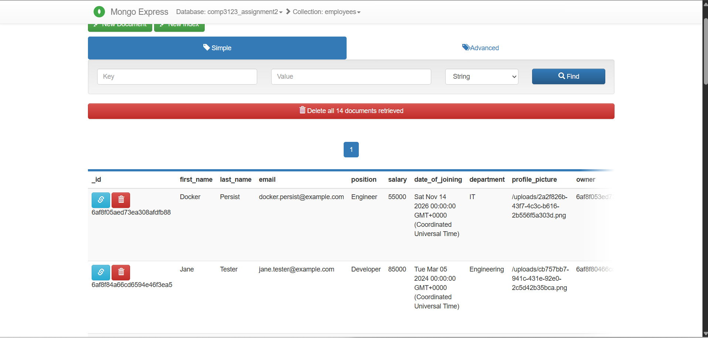

# Employee Management System — COMP 3123 Assignment 2

> Full-stack MERN app: React (Vite + MUI + TanStack Query) on top of the Assignment 1 Express/MongoDB API.
> Every user sees and manages **only their own employees**.

**Student:** <Name> · <StudentID> · **Repo:** <GitHub link>
**Test accounts (fake data only):** `alice` / `Test@1234` · `bob` / `Test@1234`

---

## 1. Project

| Layer | Tech |
|---|---|
| Frontend | React 18, Vite, React Router 6, MUI 6, TanStack Query 5, Axios |
| Backend | Node 22, Express, Mongoose, JWT, bcrypt, Multer, Helmet, express-rate-limit |
| Database | MongoDB 7 (+ mongo-express for inspection) |
| Runtime | Docker Compose (4 services) |


```
.
├── backend/            Express API (A1, extended)
├── frontend/           React app
│   └── src/{api,components,context,hooks,pages,utils}
├── postman/            Collection, environment, fixtures/
├── docs/screenshots/   Evidence 01–22
└── docker-compose.yml
```

## 2. Installation and running

```bash
git clone <repo-url> && cd <StudentID>_comp3123_assignment2_reactjs
cp .env.example .env
cp backend/.env.example backend/.env
cp frontend/.env.example frontend/.env      # only needed without Docker
docker compose up --build
```

| URL | What |
|---|---|
| http://localhost:3000 | React app |
| http://localhost:5000/health | API health check |
| http://localhost:8081 | mongo-express (basic auth from root `.env`) |

Then import `postman/EMS.postman_collection.json` + `EMS.postman_environment.json` and run folders 1–8.

`docker compose down` keeps data and pictures. `docker compose down -v` **wipes** the volumes.

**Without Docker:** start MongoDB locally, set `MONGODB_URI=mongodb://localhost:27017/comp3123_assignment2` in `backend/.env`, then `cd backend && npm install && npm run dev` and `cd frontend && npm install && npm run dev`.

## 3. Configuration

| Variable | Service | Example | Purpose |
|---|---|---|---|
| `PORT` | backend | `5000` | API port |
| `MONGODB_URI` | backend | `mongodb://mongo:27017/comp3123_assignment2` | Mongo connection (service name inside Compose) |
| `JWT_SECRET` | backend | long random string | Signs tokens |
| `JWT_EXPIRES_IN` | backend | `1h` | Token lifetime |
| `CORS_ORIGIN` | backend | `http://localhost:3000` | Only origin allowed to call the API |
| `VITE_API_URL` | frontend (build arg) | `http://localhost:5000/api/v1` | Axios baseURL used by the browser |
| `ME_USER` / `ME_PASSWORD` | mongo-express | `admin` / `change-me` | Basic auth for mongo-express |

No real values are committed; `.env` files are git-ignored.

## 4. API

Base URL `http://localhost:5000/api/v1`. 🔒 = requires `Authorization: Bearer <token>`.

| Method | Path | Auth | Body / query | Success | Errors |
|---|---|---|---|---|---|
| POST | `/user/signup` | – | `{ username, email, password }` | 201 | 400, 409, 429 |
| POST | `/user/login` | – | `{ username \| email, password }` | 200 `{ token }` | 400, 401, 429 |
| GET | `/emp/employees` | 🔒 | – | 200 `[...]` | 401 |
| POST | `/emp/employees` | 🔒 | multipart: fields + `profile_picture?` | 201 | 400, 401 |
| GET | `/emp/employees/:id` | 🔒 | – | 200 | 401, 404 |
| PUT | `/emp/employees/:id` | 🔒 | multipart | 200 | 400, 401, 404 |
| DELETE | `/emp/employees/:id` | 🔒 | – | 204 | 401, 404 |
| GET | `/emp/employees/search` | 🔒 | `?department=&position=` | 200 `[...]` | 400, 401 |

```bash
curl -X POST http://localhost:5000/api/v1/emp/employees \
  -H "Authorization: Bearer $TOKEN" \
  -F first_name=Jane -F last_name=Doe -F email=jane@example.com \
  -F position=Developer -F department=Engineering -F salary=85000 \
  -F date_of_joining=2024-03-05 -F profile_picture=@postman/fixtures/avatar.png

curl "http://localhost:5000/api/v1/emp/employees/search?department=eng" -H "Authorization: Bearer $TOKEN"
```

## 5. Authentication and authorization

- Signup hashes the password with bcrypt. Login verifies the hash and signs a JWT (`{ id }`, 1 h expiry).
- The client stores the token in `localStorage`; an Axios request interceptor sends `Authorization: Bearer`.
  Trade-off: simple and survives refresh, but readable by XSS — mitigated by CSP, React escaping, and short expiry.
- Every employee query includes `owner: req.user.id` taken from the **verified token**, never from the body.
  Another user's id matches nothing, so the API returns **404** (not 403) — it doesn't even confirm the record exists.
- `ProtectedRoute` is a UX guard only; the server checks every request.

## 6. Security

bcrypt · JWT expiry · Helmet (CORP relaxed to `cross-origin` only on `/uploads`) · rate limits (<N> logins / <M> min, `Retry-After`) · express-validator on all inputs · regex-escaped, owner-scoped search · `CORS_ORIGIN` allow-list · uploads: JPEG/PNG/WebP allow-list, 2 MB, UUID filenames, magic-byte check, orphan cleanup · nginx `nosniff` + CSP · secrets only in env vars.

## 7. Frontend

| Route | Page | Access |
|---|---|---|
| `/login`, `/signup` | Auth forms | logged-out only |
| `/employees` | List + search (`?department=&position=`) | 🔒 |
| `/employees/new` | Add | 🔒 |
| `/employees/:id` | Details | 🔒 |
| `/employees/:id/edit` | Edit | 🔒 |
| `*` | Not found | all |

- **AuthContext** — session state, login/logout, proactive logout at JWT `exp`, `queryClient.clear()` on logout.
- **Axios instance** (`src/api/client.js`) — request interceptor adds the token; response interceptor turns a 401 on protected calls into "Session expired" + redirect (login 401s stay on the form).
- **TanStack Query** — `['employees', filters]` with `keepPreviousData`; mutations invalidate the cache.
- **Search** — inputs debounced 400 ms, filters stored in the URL, always server-side.
- **Forms** — one `useForm` hook: validate on blur + submit, focus first invalid field, server `errors[]` mapped under fields.
- After signup the user is redirected to `/login` with the username pre-filled (chosen over auto-login).

## 8. Logging and health check

- Logs: `backend/logs/app.log` (requests, auth failures, errors). Passwords, tokens and `Authorization` headers are never logged.
- `GET /health` → `200 { "status": "ok", "db": "connected", ... }`, or `503` when MongoDB is down (used by the Docker health check).

## 9. Testing

- Postman folders: 1 Health · 2 Auth · 3 Employees · 4 Search · 5 Upload failures · 6 Cross-user · 7 Token failures · 8 Delete · 9 Rate limit.
- Run 1–8 in the Collection Runner (working directory = `postman/`). Run 9 alone with 11 iterations.
- Two-user UI scenario: see screenshots 14–17.
- Lighthouse accessibility: **<score>**.

## 10. Screenshots

| # | Screenshot | Proves |
|---|---|---|
| 01 |  | Hashing |
| 02 |  | Ownership, upload field |
| … | … | … |
| 22 |  | Security |

## 11. Known limitations

- Uploaded images are public by unguessable URL (no auth on `/uploads`).
- The token in `localStorage` is readable by XSS; no refresh tokens (re-login after 1 h).
- No pagination on the list.

## 12. AI usage


