# Employee Management System — COMP 3123 Assignment 2

A full-stack MERN app: a React front end (Vite, MUI, TanStack Query) on top of my Assignment 1 Express/MongoDB API, packaged with Docker Compose.
Each user signs up, logs in, and manages **only their own employees**, including profile pictures and server-side search.

| | |
|---|---|
| **Student** | Karthik Madarapu · 101564894 |
| **Course** | COMP 3123 — Assignment 2 |
| **Repository** | <https://github.com/karthikmadarapu/101564894_comp3123_assignment2_reactjs> |

---

## Contents

1. [Quick start](#1-quick-start)
2. [Features](#2-features)
3. [Architecture](#3-architecture)
4. [Configuration](#4-configuration)
5. [API reference](#5-api-reference)
6. [Authentication and authorization](#6-authentication-and-authorization)
7. [Security](#7-security)
8. [Frontend](#8-frontend)
9. [Error handling](#9-error-handling)
10. [Logging and health check](#10-logging-and-health-check)
11. [Testing](#11-testing)
12. [Screenshots](#12-screenshots)
13. [Troubleshooting](#13-troubleshooting)
14. [Known limitations](#14-known-limitations)
15. [AI usage](#15-ai-usage)

---

## 1. Quick start

**Requirements:** Docker Desktop (Compose v2). Nothing else needs to be installed.

```bash
git clone https://github.com/karthikmadarapu/101564894_comp3123_assignment2_reactjs.git
cd 101564894_comp3123_assignment2_reactjs
cp .env.example .env                 # mongo-express login + API URL baked into the frontend
cp backend/.env.example backend/.env # replace JWT_SECRET with a long random string
docker compose up --build
```

When `docker compose ps` shows the backend as **healthy**, open:

| URL | What |
|---|---|
| <http://localhost:3000> | React app |
| <http://localhost:5000/health> | API health check |
| <http://localhost:8081> | mongo-express (login = `ME_USER` / `ME_PASSWORD` from the root `.env`) |

A fresh install has no users. Sign up two accounts (for example `alice` and `bob`, password at least 8 characters) to try the ownership rules.

- `docker compose down` stops everything and **keeps** data and pictures.
- `docker compose down -v` also **wipes** the database and uploaded pictures.

<details>
<summary><b>Running without Docker</b></summary>

1. Start MongoDB locally on port 27017 (`backend/.env.example` already points at `mongodb://127.0.0.1:27017/comp3123_assignment2`).
2. `cp frontend/.env.example frontend/.env`
3. `cd backend && npm install && npm run dev`
4. `cd frontend && npm install && npm run dev` → <http://localhost:3000>

Stop the Compose stack first — both use port 5000.
</details>

---

## 2. Features

| Requirement | Where it lives |
|---|---|
| Signup and login (username **or** email) with client and server validation | `LoginPage`, `SignupPage`, `useForm`, `utils/validators.js` |
| Logout, protected routes, session kept across refresh | `AuthProvider`, `ProtectedRoute`, token in `localStorage` |
| List employees with picture thumbnails and initials fallback | `EmployeeListPage`, `EmployeeTable`, `EmployeeAvatar` |
| Add, view details, edit, delete (with confirmation) | `AddEmployeePage`, `EmployeeDetailsPage`, `EditEmployeePage`, `ConfirmDialog` |
| Profile picture upload with preview, type and size checks | `AvatarUpload` (client) + Multer and magic-byte check (server) |
| Search by department and/or position (server-side, partial, case-insensitive) | `SearchBar`, `GET /emp/employees/search` |
| Every user sees only their own data | `owner` field on every employee; all queries filtered by the JWT user id |
| Loading, empty, error and not-found states | skeletons, `QueryError`, `NotFoundPanel`, `NotFoundPage`, `ErrorBoundary` |
| Responsive layout (375 px → desktop) | MUI breakpoints; columns collapse under 600 px, navbar becomes a menu |
| Docker Compose: MongoDB, mongo-express, API, nginx frontend | `docker-compose.yml`, Dockerfiles, health checks, named volumes |
| Automated API tests | `postman/` collection — 9 folders, 47 assertions + rate-limit run |

---

## 3. Architecture

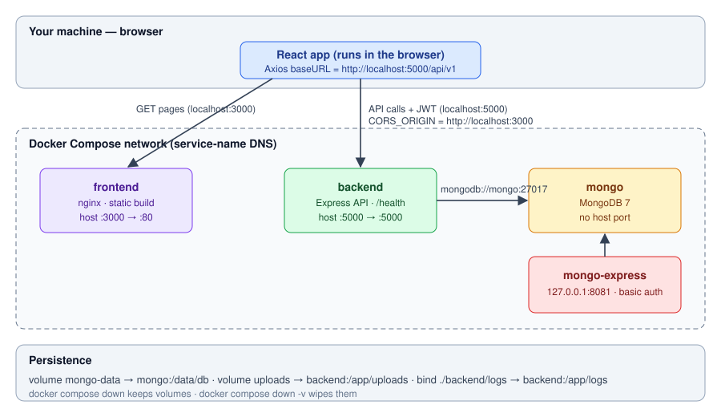

| Service | Image / build | Host port | Notes |
|---|---|---|---|
| `frontend` | `frontend/Dockerfile` (Vite build → nginx 1.27) | 3000 → 80 | SPA fallback so deep links survive a refresh; starts after the backend is healthy |
| `backend` | `backend/Dockerfile` (Node 22 alpine, non-root user) | 5000 | Health check on `/health` |
| `mongo` | `mongo:7` | none | Only reachable inside the Compose network |
| `mongo-express` | `mongo-express:1` | 127.0.0.1:8081 | Basic auth; bound to localhost only |

**Volumes:** `mongo-data` (database), `uploads` (pictures), and a bind mount `./backend/logs` so the log file can be read on the host.

### Why does the frontend call `localhost:5000` and not `backend:5000`?

Containers reach each other by **service name**: the backend connects to `mongodb://mongo:27017`.
But the React code is downloaded from nginx and then runs **in the browser on the host machine**, which knows nothing about Compose DNS.
So the browser calls `http://localhost:5000/api/v1` (`VITE_API_URL`, baked in at build time), and the backend only accepts that cross-origin request from `CORS_ORIGIN=http://localhost:3000`.

`backend/.env` is shared by local development and Docker: it uses `127.0.0.1` for MongoDB, and `docker-compose.yml` overrides `MONGODB_URI` (and `NODE_ENV`) for the container only.

### Project layout

```
.
├── backend/                 Express API (Assignment 1, extended)
│   └── src/{config,controllers,middleware,models,routes,services,utils,validators}
├── frontend/                React app
│   └── src/{api,components,context,hooks,pages,utils}
├── postman/                 Collection, environment, fixtures/ (test images)
├── docs/                    architecture.svg, screenshots/
├── docker-compose.yml
└── .env.example
```

### Tech stack

| Layer | Tech |
|---|---|
| Frontend | React 19, Vite 8, React Router 7, MUI 9, TanStack Query 5, Axios |
| Backend | Node 22, Express 5, Mongoose 9, jsonwebtoken, bcryptjs, Multer, Helmet, express-rate-limit, express-validator, winston |
| Database | MongoDB 7 (+ mongo-express) |
| Runtime | Docker Compose, nginx |

---

## 4. Configuration

All secrets come from environment variables; every `.env` file is git-ignored and only `.env.example` files are committed.

| Variable | File | Example | Purpose |
|---|---|---|---|
| `ME_USER` / `ME_PASSWORD` | `.env` | `admin` / `change-me` | mongo-express basic auth |
| `VITE_API_URL` | `.env` (build arg) / `frontend/.env` | `http://localhost:5000/api/v1` | Axios base URL used by the browser |
| `PORT` | `backend/.env` | `5000` | API port |
| `MONGODB_URI` | `backend/.env` | `mongodb://127.0.0.1:27017/comp3123_assignment2` | Local MongoDB (Compose overrides it with `mongodb://mongo:27017/...`) |
| `JWT_SECRET` | `backend/.env` | long random string | Signs tokens |
| `JWT_EXPIRES_IN` | `backend/.env` | `1h` | Token lifetime |
| `CORS_ORIGIN` | `backend/.env` | `http://localhost:3000` | Only origin allowed to call the API (no trailing slash) |
| `UPLOAD_DIR` / `MAX_UPLOAD_MB` | `backend/.env` | `uploads` / `2` | Picture storage and size limit |
| `RATE_LIMIT_MAX` | `backend/.env` | `10` | Login/signup attempts per 15 min per IP |
| `LOG_LEVEL` | `backend/.env` | `info` | winston log level |

> `VITE_API_URL` is compiled into the frontend. After changing it, rebuild with `docker compose up --build`.

---

## 5. API reference

Base URL `http://localhost:5000/api/v1`. 🔒 = requires `Authorization: Bearer <token>`.

| Method | Path | Auth | Body / query | Success | Errors |
|---|---|---|---|---|---|
| POST | `/user/signup` | – | `{ username, email, password }` | 201 `{ user_id }` | 400, 409, 429 |
| POST | `/user/login` | – | `{ username \| email, password }` | 200 `{ token, user }` | 400, 401, 429 |
| GET | `/emp/employees` | 🔒 | – | 200 `data: [...]` | 401 |
| POST | `/emp/employees` | 🔒 | multipart: fields + optional `profile_picture` | 201 `data: {...}` | 400, 401 |
| GET | `/emp/employees/:eid` | 🔒 | – | 200 `data: {...}` | 400, 401, 404 |
| PUT | `/emp/employees/:eid` | 🔒 | multipart; `remove_picture=true` clears the picture | 200 `data: {...}` | 400, 401, 404 |
| DELETE | `/emp/employees?eid=<id>` | 🔒 | – | 204 | 400, 401, 404 |
| GET | `/emp/employees/search` | 🔒 | `?department=&position=` (at least one) | 200 `data: [...]` | 400, 401 |
| GET | `/health` (no `/api/v1` prefix) | – | – | 200 | 503 |

**Employee fields:** `first_name`, `last_name`, `email`, `position`, `department`, `salary`, `date_of_joining` (`YYYY-MM-DD`), `profile_picture` (file: JPEG, PNG or WebP, ≤ 2 MB).

**Response shapes**

```jsonc
// success
{ "status": true, "message": "Employee created", "data": { "_id": "...", "first_name": "Jane", "profile_picture": "/uploads/<uuid>.png", ... } }

// error
{ "status": false, "message": "Validation failed", "code": "VALIDATION_ERROR",
  "errors": [ { "field": "email", "message": "Must be a valid email" } ] }
```

**Examples**

```bash
TOKEN=$(curl -s -X POST http://localhost:5000/api/v1/user/login \
  -H "Content-Type: application/json" -d '{"username":"alice","password":"Test@1234"}' | jq -r .token)

curl -X POST http://localhost:5000/api/v1/emp/employees -H "Authorization: Bearer $TOKEN" \
  -F first_name=Jane -F last_name=Doe -F email=jane@example.com \
  -F position=Developer -F department=Engineering -F salary=85000 \
  -F date_of_joining=2024-03-05 -F profile_picture=@postman/fixtures/avatar.png

curl "http://localhost:5000/api/v1/emp/employees/search?department=eng" -H "Authorization: Bearer $TOKEN"
curl -X DELETE "http://localhost:5000/api/v1/emp/employees?eid=<id>" -H "Authorization: Bearer $TOKEN"
```

---

## 6. Authentication and authorization

- **Signup** hashes the password with bcrypt; the plain password is never stored or logged.
- **Login** accepts a username or an email, verifies the hash, and returns a JWT (`{ id }`, 1 h expiry).
- **Client:** the token is kept in `localStorage`, and an Axios request interceptor adds `Authorization: Bearer <token>` to every API call.
  *Trade-off:* simple and survives a refresh, but readable by injected scripts — mitigated by CSP, React's output escaping, and the short expiry.
- **Ownership:** every employee document stores `owner`. Every query adds `owner: req.user.id`, taken from the **verified token**, never from the request body.
  Another user's id therefore matches nothing, and the API answers **404, not 403** — it does not even confirm the record exists.
- **Session end:** the client logs out proactively when the JWT `exp` is reached, and on any 401 from a protected call; logout clears the TanStack Query cache so the next user never sees cached data.
- `ProtectedRoute` is a UX guard only; the server checks every request.
- After signup, the user is sent to `/login` with the username pre-filled (chosen over auto-login so the credentials are confirmed once).

---

## 7. Security

| Area | Measures |
|---|---|
| Passwords and tokens | bcrypt hashes · JWT with expiry · secret only in env vars |
| Authorization | owner-scoped queries · 404 for other users' ids · id format validated (`isMongoId`) |
| Rate limiting | login/signup **10 / 15 min** per IP · whole API **100 / 15 min** · standard `RateLimit` headers + `Retry-After` (exposed via CORS so the UI can say "try again in N minutes") |
| Input validation | express-validator on every body, param and query · rejects objects such as `{"$gt": ""}` and `department[$ne]=x` · search input regex-escaped (`.*` matches nothing) |
| HTTP headers | Helmet (CSP, HSTS, `nosniff`, `X-Frame-Options`, Referrer-Policy…) · `Cross-Origin-Resource-Policy: cross-origin` so the app on :3000 can display pictures from :5000 · CORS allow-list from `CORS_ORIGIN` · nginx adds its own CSP and `nosniff` |
| Uploads | JPEG/PNG/WebP allow-list · 2 MB limit · magic-byte check (a text file renamed `.png` is rejected) · random UUID filenames · old file deleted on replace or delete, so no orphans |
| Containers | backend runs as non-root `node` user · MongoDB has no host port · mongo-express bound to 127.0.0.1 with basic auth |
| Logging | no passwords, tokens or `Authorization` headers in logs |

---

## 8. Frontend

| Route | Page | Access |
|---|---|---|
| `/login`, `/signup` | Auth forms | logged-out only |
| `/employees` | List + search (`?department=&position=`) | 🔒 |
| `/employees/new` | Add | 🔒 |
| `/employees/:id` | Details | 🔒 |
| `/employees/:id/edit` | Edit | 🔒 |
| `*` | Not found | all |

- **API layer** (`src/api/`): one Axios instance; the response interceptor turns a 401 on protected calls into "Your session expired" + redirect, while login/signup 401s stay on the form.
- **Server state:** TanStack Query with the key `['employees', filters]` and `keepPreviousData`; every mutation invalidates the cache.
- **Search:** inputs debounced 400 ms, trimmed, stored in the URL (refresh and Back keep the filter), always executed on the server.
- **Forms:** one `useForm` hook — validate on blur and on submit, focus the first invalid field, show server `errors[]` under the matching field. Add and Edit share one `EmployeeForm`.
- **Uploads:** client-side type/size check before any request; preview via `createObjectURL` (revoked on cleanup); server 400s still appear under the picker.
- **UX:** one MUI theme; toasts for create, update, delete, logout and session expiry; the delete dialog names the employee; `document.title` per page (`Employees · EMS`); alt text on every avatar; salaries in CAD, dates in UTC.
- **Accessibility:** labelled inputs with `aria-invalid` / `aria-describedby`, keyboard-reachable upload button, visible focus. Lighthouse accessibility score: **<score>**.

---

## 9. Error handling

| Scenario | What the user sees | Where it's handled |
|---|---|---|
| Wrong username or password (401) | Alert on the login form | `LoginPage` (interceptor skips auth paths) |
| Duplicate username or email (409) | "That username or email is already registered" | `SignupPage` |
| Validation error (400 + `errors[]`) | Message under each field | `getFieldErrors` → `useForm` |
| Expired or tampered token | Toast "Your session expired" → login page | Axios interceptor → `AuthProvider` (also proactive at `exp`) |
| Another user's id, or a bad id | "Employee not found" panel with a link back | `isNotFound()` → `NotFoundPanel` |
| Too many attempts (429) | "Try again in N minutes"; login button disabled until then | `getErrorMessage` reads `Retry-After` |
| Server down / 5xx | "Can't reach the server…" / "The server had a problem…" + Retry | `QueryError`, `api/errors.js` |
| Wrong file type / file too large | Message under the picture picker (client first, server as backup) | `AvatarUpload` |
| Unknown URL | Not-found page | `*` route → `NotFoundPage` |
| Unexpected render error | Friendly fallback, no stack trace; resets on navigation | `ErrorBoundary` |

---

## 10. Logging and health check

- **Logs:** `backend/logs/app.log`, one JSON object per line (winston): every request with status and duration, logins and failed logins, uploads, and errors.
  From Docker: `docker compose exec backend tail -n 50 logs/app.log`.
- **Health:** `GET /health` → `200 { "status": "ok", "db": "connected", "uptime": …, "timestamp": … }`, or `503 { "status": "degraded", "db": "disconnected" }` when MongoDB is unreachable.
  Docker uses it as the backend health check, and the frontend container waits for it.

---

## 11. Testing

### Postman

1. Import `postman/EMS.postman_collection.json` and `postman/EMS.postman_environment.json`, then select the **EMS local** environment.
2. *Settings → General → Working directory* = this repo's `postman/` folder (so the fixture images upload).
3. Run folders **1–8** together in the Collection Runner. Usernames are unique per run, so it can be repeated.

| Folder | Covers |
|---|---|
| 1 Health | `/health` 200 |
| 2 Auth | signup 201, duplicate 409, invalid 400, login by username and by email, wrong password 401 |
| 3 Employees | create with/without picture, list, get, update with a new picture, old picture deleted, invalid salary 400 |
| 4 Search | partial, case-insensitive, both filters, no match, no params 400, regex escaped, operator injection 400 |
| 5 Upload failures | renamed text file, > 2 MB, PDF → 400 |
| 6 Cross-user | user B gets 404 on A's employee for GET, PUT and DELETE; A's record still exists |
| 7 Token failures | missing, tampered, expired token → 401 |
| 8 Delete | delete own employee 204, then GET 404 |
| 9 Rate limit | run **alone with 11 iterations**: 10 × 401, then 429 with `Retry-After` |

For "Expired token", paste a token signed with a past `exp` into the `expiredToken` variable (or skip that one request).

The same runs from a terminal with the Postman CLI:

```bash
postman collection run postman/EMS.postman_collection.json -e postman/EMS.postman_environment.json \
  --working-dir postman -i "1 Health" -i "2 Auth" -i "3 Employees (A)" -i "4 Search (A)" \
  -i "5 Upload failures" -i "6 Cross-user (B uses A's ids)" -i "7 Token failures" -i "8 Delete"

postman collection run postman/EMS.postman_collection.json -e postman/EMS.postman_environment.json \
  -i "9 Rate limit (run LAST, 11 iterations)" -n 11
```

> The rate-limit run locks login for 15 minutes. `docker compose restart backend` resets the in-memory limiter.

### Manual checks

- Two users side by side (normal + incognito window): each sees only their own list and search results; opening the other user's `/employees/<id>` or `/employees/<id>/edit` shows "Employee not found" with a 404 in the Network tab.
- Logout, then Back → stays on `/login`. Visiting `/employees` while logged out → redirected to `/login`.
- Edit `localStorage.token` by one character and click anything → "session expired" toast and login page.
- Responsive at 375, 768 and 1440 px; keyboard-only navigation through the forms and table actions.
- Persistence: create an employee with a picture → `docker compose down` → `docker compose up` → still there.

---

## 12. Screenshots

All images are in [`docs/screenshots/`](docs/screenshots/).

### Database

| # | Screenshot | Proves |
|---|---|---|
| 01 | 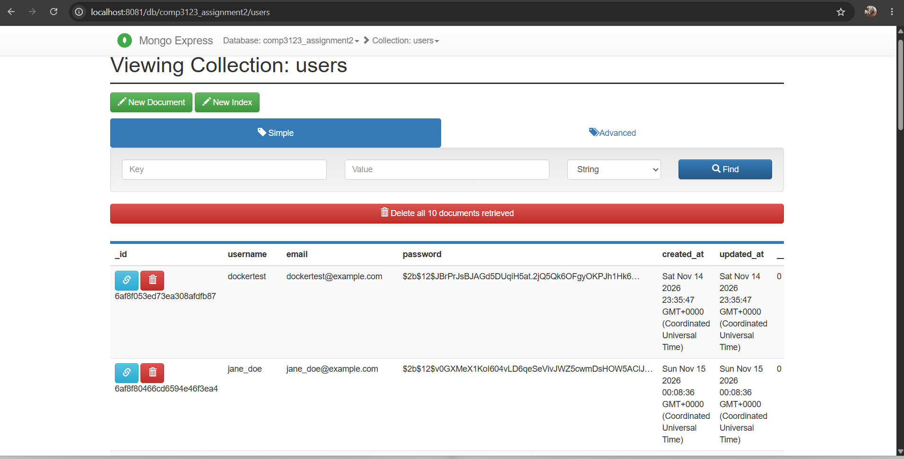 | Passwords are stored as bcrypt hashes |
| 02 |  | Each employee has an `owner` and a `profile_picture` path |

### Authentication

| # | Screenshot | Proves |
|---|---|---|
| 03a | 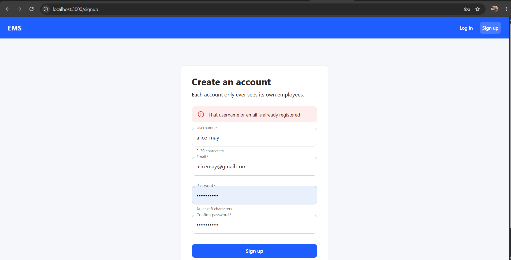 | 409 duplicate username/email shown as an Alert; field hints shown before typing |
| 03b | 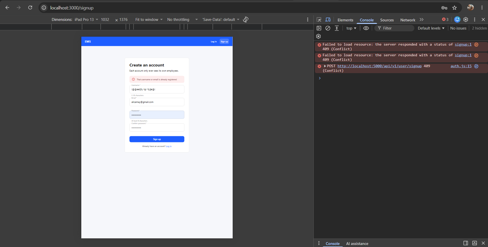 | The 409 comes from the API (`POST /user/signup`) |
| 04 |  | Wrong credentials → 401 Alert, user stays on the form |

### Employees

| # | Screenshot | Proves |
|---|---|---|
| 05 | 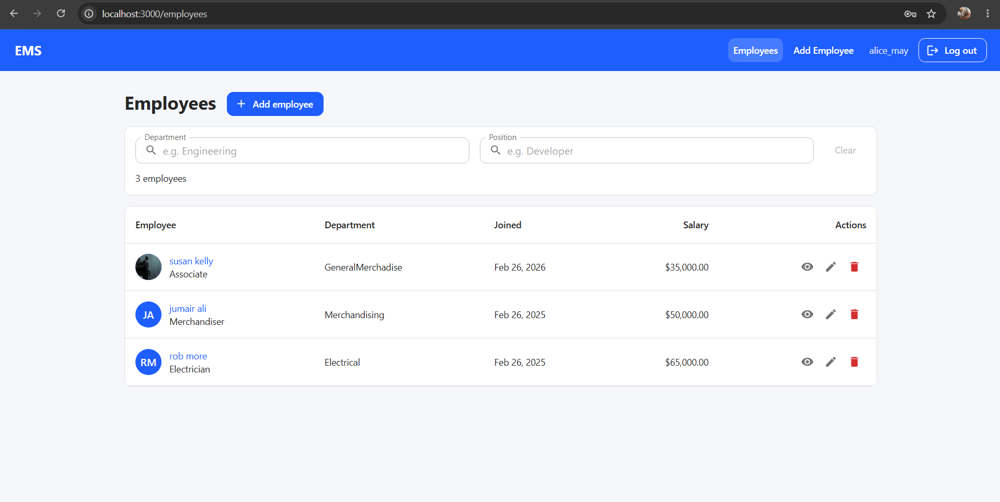 | List with picture thumbnails and initials placeholders |
| 06 | 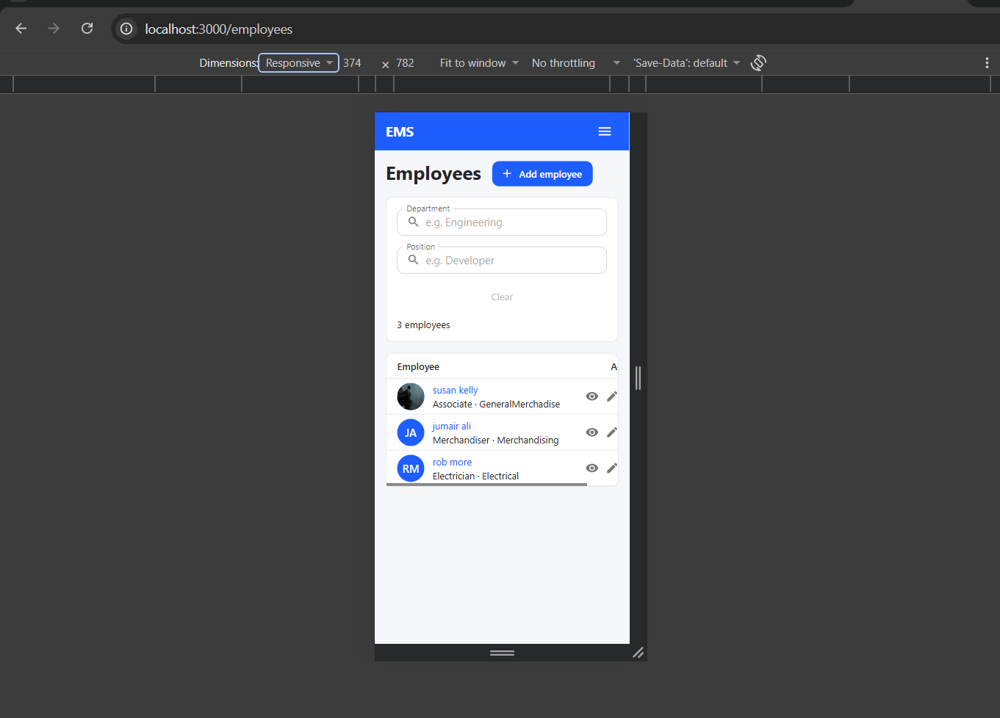 | Responsive layout at 375 px, no horizontal scroll |
| 07 | 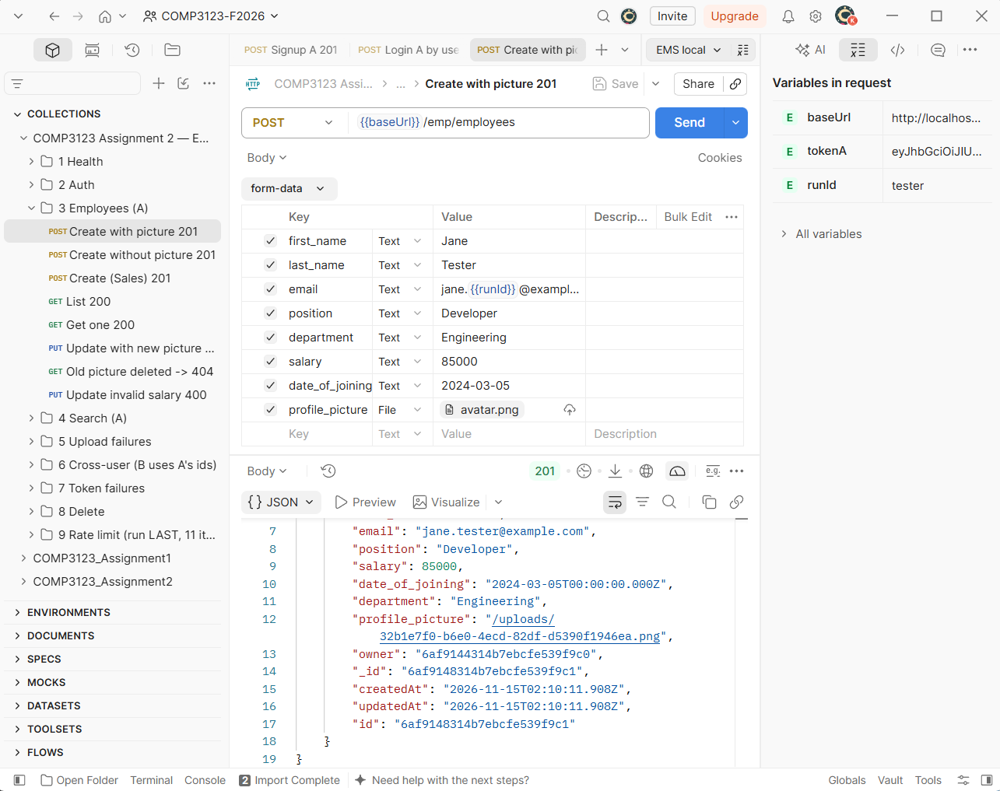 | Add form with picture preview |
| 08 | 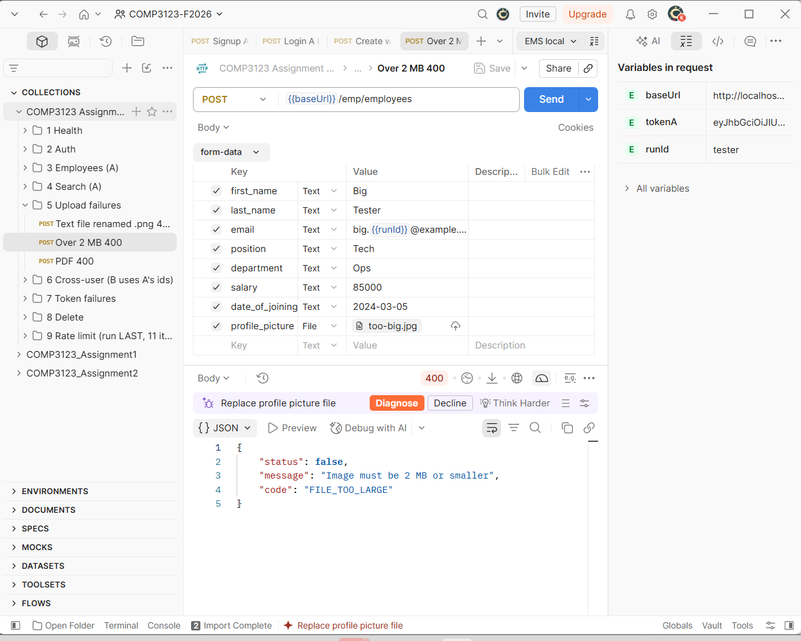 | Server rejects a picture over 2 MB (`FILE_TOO_LARGE`) |
| 09 |  | Details page: large avatar, CAD salary, formatted date |
| 10 | 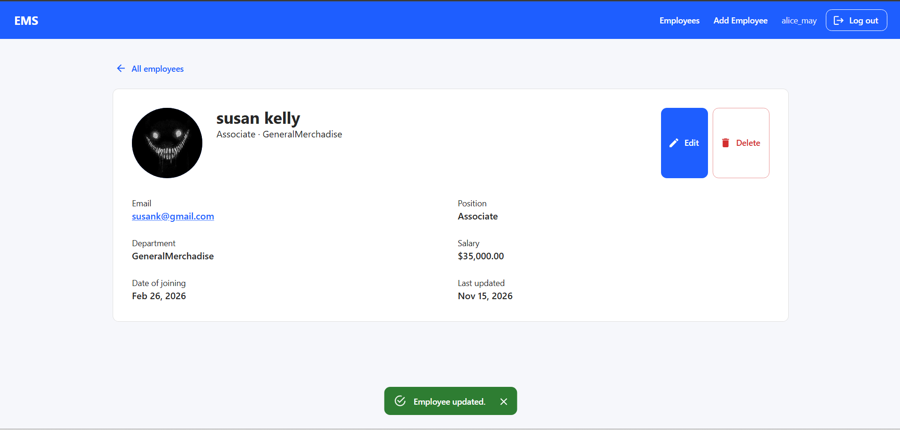 | Edit form pre-filled, picture replaced |
| 11 | 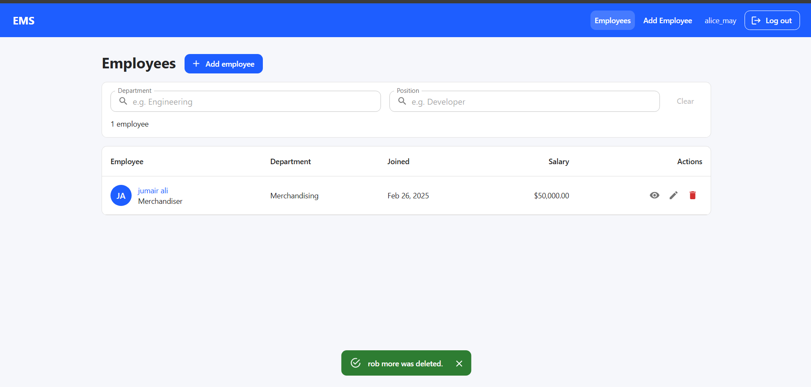 | Delete confirmed: list refreshed and success toast |

### Search

| # | Screenshot | Proves |
|---|---|---|
| 12 |  | Server-side, debounced search: one `/search` request |
| 13 | 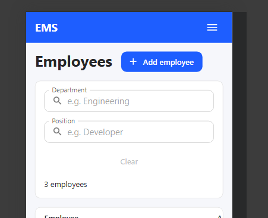 | Clear resets the filters and shows the full list |

### Ownership and session

| # | Screenshot | Proves |
|---|---|---|
| 14 | 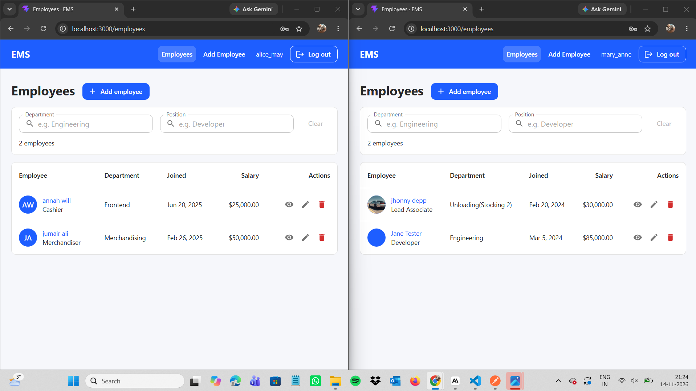 | Two users side by side see only their own employees |
| 15 |  | Opening another user's employee URL → "Employee not found", 404 in Network |
| 16 |  | After logout, Back stays on the login page |
| 18 | 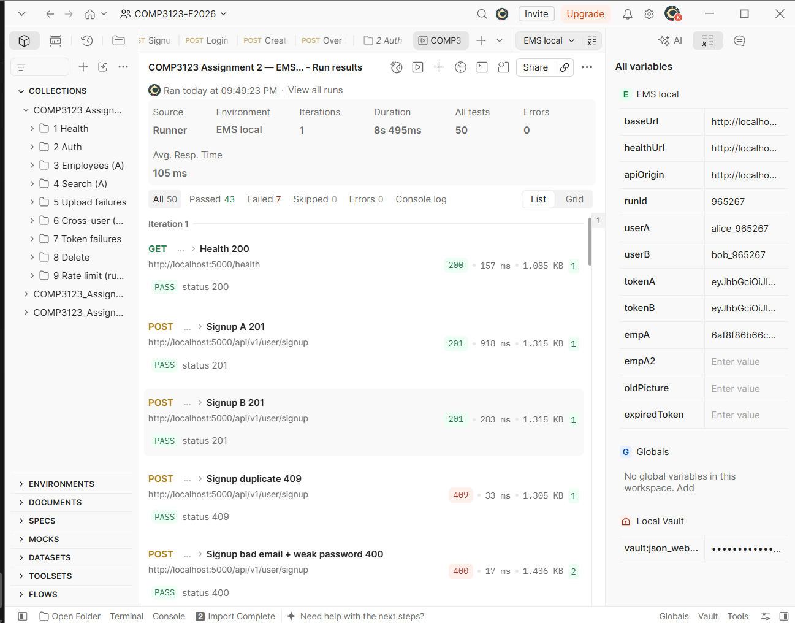 | Rate limit: 429 shown with "try again in N minutes" |

### Docker, logging and API tests

| # | Screenshot | Proves |
|---|---|---|
| 19a | 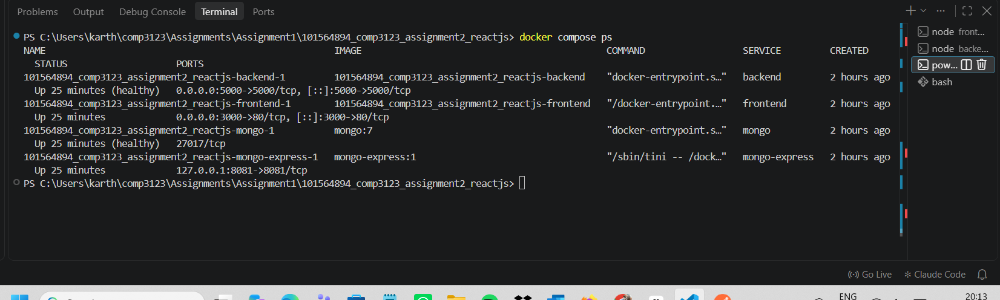 | All services running; backend and mongo **healthy** |
| 19b | 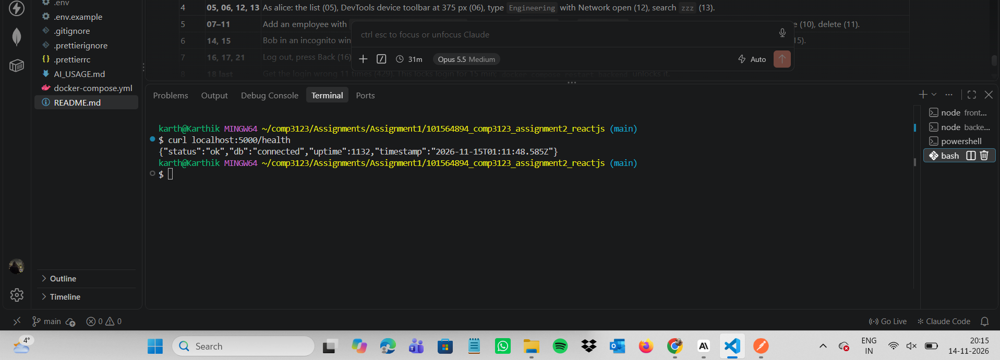 | `/health` returns 200 JSON |
| 20 | 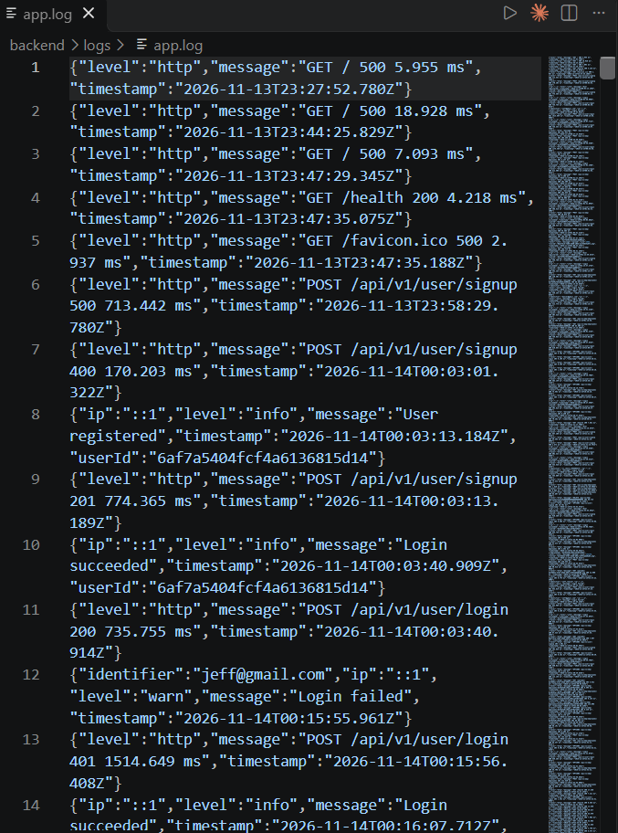 | Structured log with no passwords or tokens |
| 21 | 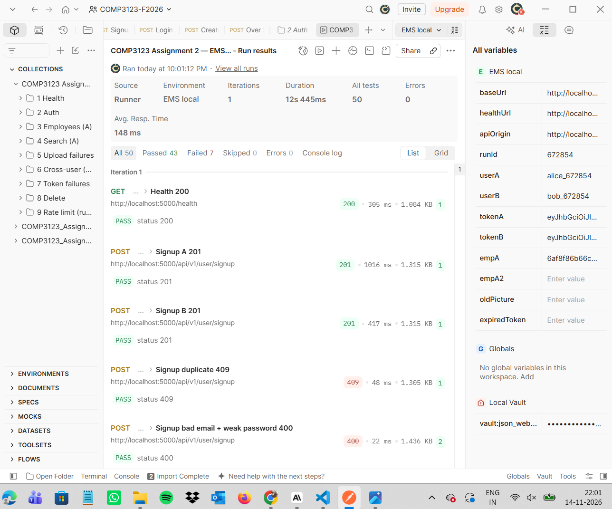 | Postman Runner, folders 1–8 all passing |
| 22 |  | Helmet and CORS headers on an API response |

---

## 13. Troubleshooting

| Symptom | Fix |
|---|---|
| Frontend container exits or shows a blank page | `docker compose logs frontend`; after changing `VITE_API_URL`, rebuild with `docker compose up --build` |
| CORS error in the browser console | `CORS_ORIGIN` must be exactly `http://localhost:3000` (no trailing slash) |
| Port 5000, 3000 or 8081 already in use | Stop the other process (or a local `npm run dev`) and run `docker compose up` again |
| Backend stays "starting" / unhealthy | `docker compose logs backend`; check `backend/.env` exists and `JWT_SECRET` is set |
| Login always says "try again in N minutes" | The rate limit was hit; wait, or `docker compose restart backend` |
| Want a clean database | `docker compose down -v && docker compose up --build` |

---

## 14. Known limitations

- Uploaded pictures are public to anyone who has the (random, unguessable) URL; `/uploads` is not behind auth.
- The token in `localStorage` is readable by injected scripts; there are no refresh tokens, so users log in again after 1 h.
- The employee list has no pagination.
- The rate limiter stores counts in memory: it resets when the backend restarts and would not be shared between several backend instances.

---

## 15. AI usage

AI tools were used as an assistant. I reviewed, ran and tested every change myself.
The full log (date, tool, purpose, what I changed or verified) is in [AI_USAGE.md](AI_USAGE.md).
