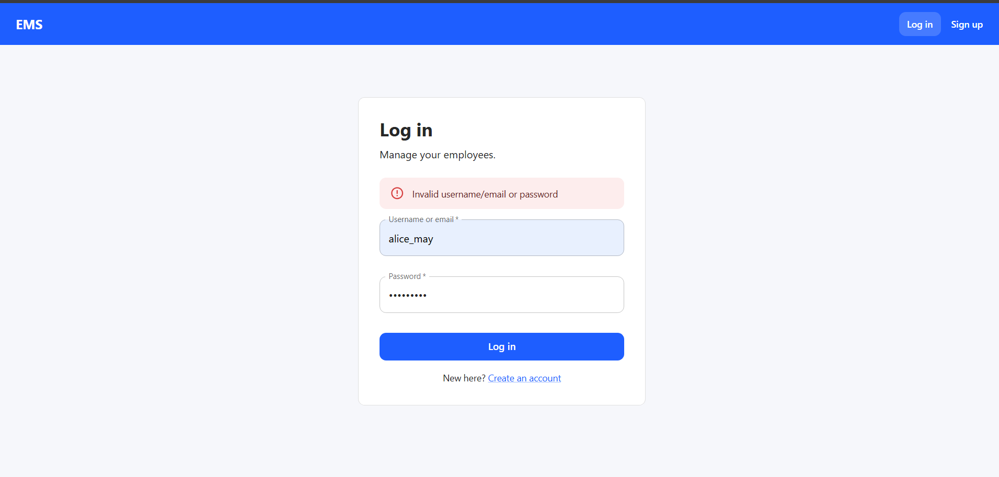
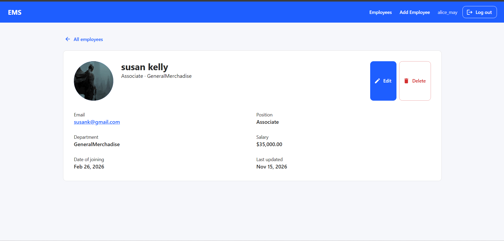
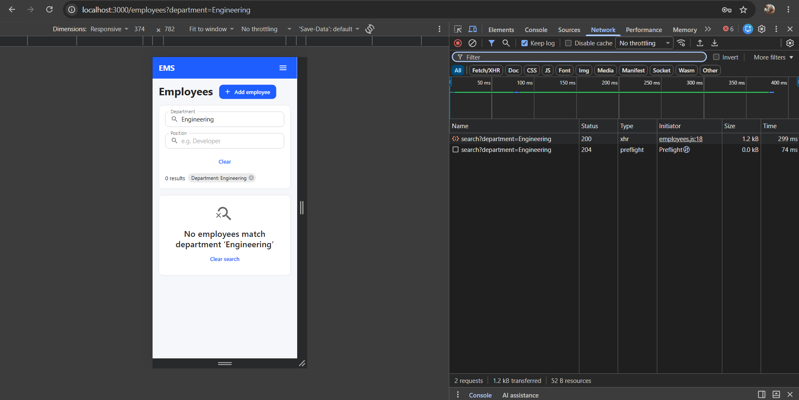
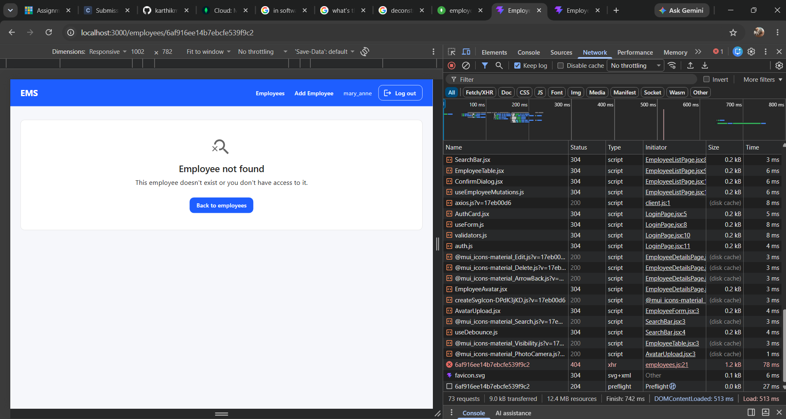
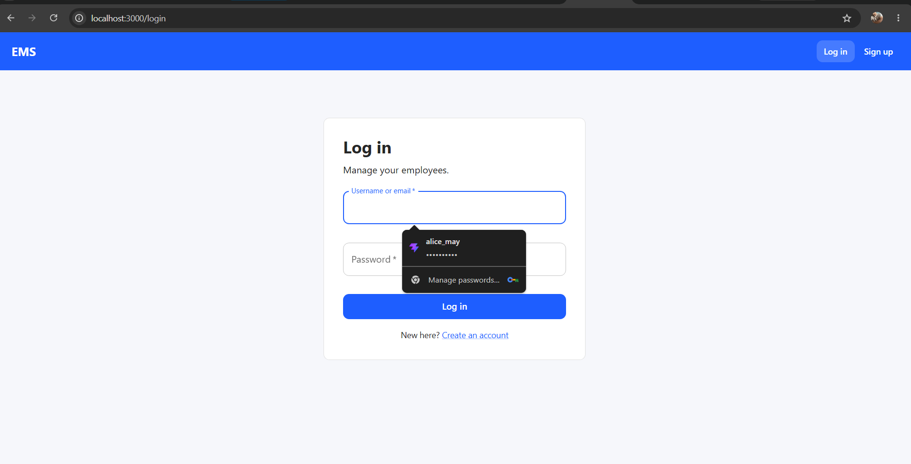
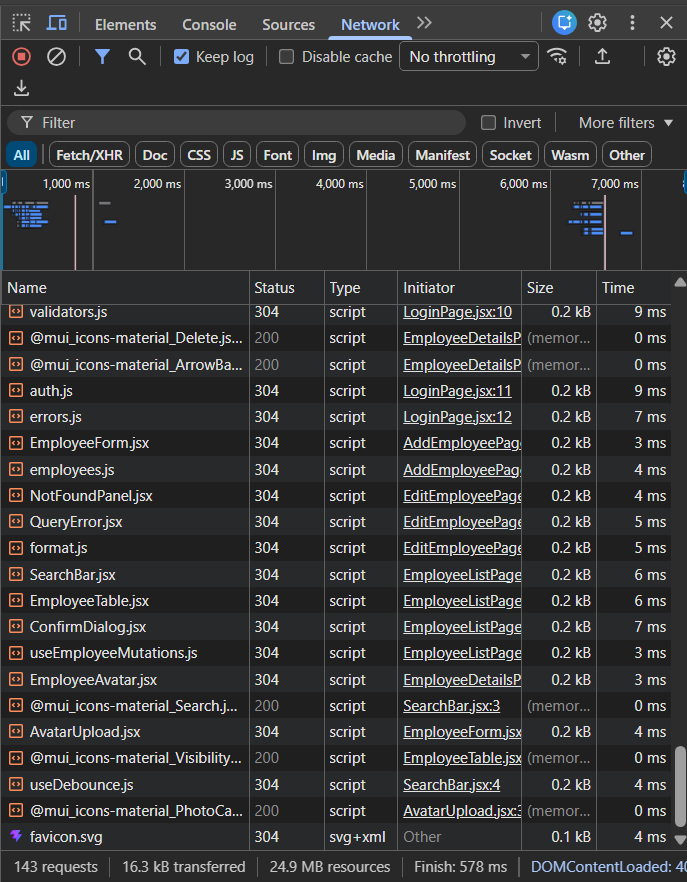

# Employee Management System — COMP 3123 Assignment 2

> Full-stack MERN app: React (Vite + MUI + TanStack Query) on top of the Assignment 1 Express/MongoDB API.
> Every user sees and manages **only their own employees**.

**Student:** Karthik Madarapu · 101564894 · **Repo:** <https://github.com/karthikmadarapu/101564894_comp3123_assignment2_reactjs>
**Test accounts (fake data only):** `alice` / `Test@1234` · `bob` / `Test@1234`

---

## 1. Project

| Layer | Tech |
|---|---|
| Frontend | React 19, Vite 8, React Router 7, MUI 9, TanStack Query 5, Axios |
| Backend | Node 22, Express 5, Mongoose 9, JWT, bcrypt, Multer, Helmet, express-rate-limit, winston |
| Database | MongoDB 7 (+ mongo-express for inspection) |
| Runtime | Docker Compose (4 services) |


```
.
├── backend/            Express API (A1, extended)
├── frontend/           React app
│   └── src/{api,components,context,hooks,pages,utils}
├── postman/            Collection, environment, fixtures/
├── docs/               architecture.svg, screenshots/ (evidence 01–22)
└── docker-compose.yml
```

## 2. Installation and running

```bash
git clone https://github.com/karthikmadarapu/101564894_comp3123_assignment2_reactjs.git
cd 101564894_comp3123_assignment2_reactjs
cp .env.example .env
cp backend/.env.example backend/.env        # set a long random JWT_SECRET
cp frontend/.env.example frontend/.env      # only needed without Docker
docker compose up --build
```

| URL | What |
|---|---|
| http://localhost:3000 | React app |
| http://localhost:5000/health | API health check |
| http://localhost:8081 | mongo-express (basic auth from root `.env`) |

Then sign up a user in the app, or import the Postman collection (section 9).

`docker compose down` keeps data and pictures. `docker compose down -v` **wipes** the volumes.

**Without Docker:** start MongoDB locally (`backend/.env.example` already points at `mongodb://127.0.0.1:27017/comp3123_assignment2`), then `cd backend && npm install && npm run dev` and `cd frontend && npm install && npm run dev`. Stop the Compose stack first — both use port 5000.

### Why `localhost:5000` and not `backend:5000`?

Containers reach each other by **service name**: the backend connects to `mongodb://mongo:27017`, and Compose overrides `MONGODB_URI` with that value so the same `backend/.env` also works for local development.
The React code, however, runs **in the browser on the host**, which knows nothing about Compose DNS. So the frontend calls `http://localhost:5000/api/v1`, and the backend allows `CORS_ORIGIN=http://localhost:3000`.

## 3. Configuration

| Variable | Service | Example | Purpose |
|---|---|---|---|
| `PORT` | backend | `5000` | API port |
| `MONGODB_URI` | backend | `mongodb://127.0.0.1:27017/comp3123_assignment2` | Local Mongo; Compose overrides it with `mongodb://mongo:27017/...` |
| `JWT_SECRET` | backend | long random string | Signs tokens |
| `JWT_EXPIRES_IN` | backend | `1h` | Token lifetime |
| `CORS_ORIGIN` | backend | `http://localhost:3000` | Only origin allowed to call the API |
| `MAX_UPLOAD_MB` | backend | `2` | Picture size limit |
| `RATE_LIMIT_MAX` | backend | `10` | Login/signup attempts per 15 min per IP |
| `LOG_LEVEL` | backend | `info` | winston log level |
| `VITE_API_URL` | frontend (build arg) | `http://localhost:5000/api/v1` | Axios baseURL used by the browser |
| `ME_USER` / `ME_PASSWORD` | mongo-express | `admin` / `change-me` | Basic auth for mongo-express |

No real values are committed; `.env` files are git-ignored.

## 4. API

Base URL `http://localhost:5000/api/v1`. 🔒 = requires `Authorization: Bearer <token>`.
Success responses use the envelope `{ status: true, message, data }`; errors use `{ status: false, message, code?, errors?: [{ field, message }] }`.

| Method | Path | Auth | Body / query | Success | Errors |
|---|---|---|---|---|---|
| POST | `/user/signup` | – | `{ username, email, password }` | 201 `{ user_id }` | 400, 409, 429 |
| POST | `/user/login` | – | `{ username \| email, password }` | 200 `{ token, user }` | 400, 401, 429 |
| GET | `/emp/employees` | 🔒 | – | 200 `data: [...]` | 401 |
| POST | `/emp/employees` | 🔒 | multipart: fields + `profile_picture?` | 201 `data: {...}` | 400, 401 |
| GET | `/emp/employees/:eid` | 🔒 | – | 200 | 400, 401, 404 |
| PUT | `/emp/employees/:eid` | 🔒 | multipart (+ `remove_picture=true`) | 200 | 400, 401, 404 |
| DELETE | `/emp/employees?eid=<id>` | 🔒 | – | 204 | 400, 401, 404 |
| GET | `/emp/employees/search` | 🔒 | `?department=&position=` (partial, case-insensitive) | 200 `data: [...]` | 400, 401 |

```bash
curl -X POST http://localhost:5000/api/v1/emp/employees \
  -H "Authorization: Bearer $TOKEN" \
  -F first_name=Jane -F last_name=Doe -F email=jane@example.com \
  -F position=Developer -F department=Engineering -F salary=85000 \
  -F date_of_joining=2024-03-05 -F profile_picture=@postman/fixtures/avatar.png

curl "http://localhost:5000/api/v1/emp/employees/search?department=eng" -H "Authorization: Bearer $TOKEN"
curl -X DELETE "http://localhost:5000/api/v1/emp/employees?eid=<id>" -H "Authorization: Bearer $TOKEN"
```

## 5. Authentication and authorization

- Signup hashes the password with bcrypt. Login verifies the hash and signs a JWT (`{ id }`, 1 h expiry).
- The client stores the token in `localStorage`; an Axios request interceptor sends `Authorization: Bearer`.
  Trade-off: simple and survives refresh, but readable by XSS — mitigated by CSP, React escaping, and short expiry.
- Every employee query includes `owner: req.user.id` taken from the **verified token**, never from the body.
  Another user's id matches nothing, so the API returns **404** (not 403) — it doesn't even confirm the record exists.
- `ProtectedRoute` is a UX guard only; the server checks every request.

## 6. Security

- **Auth:** bcrypt hashes · JWT with expiry · owner-scoped queries (404 for other users' ids).
- **Rate limits:** login/signup **10 requests / 15 min** per IP, whole API **100 requests / 15 min**, standard `RateLimit` headers plus `Retry-After` (exposed via CORS so the UI can say "try again in N minutes").
- **Input:** express-validator on every body/param/query (rejects objects like `{"$gt": ""}`) · search input regex-escaped and owner-scoped.
- **Headers:** Helmet defaults (CSP, HSTS, `nosniff`, frame-ancestors…), with `Cross-Origin-Resource-Policy: cross-origin` so the app on `:3000` can display pictures served by `:5000` · `CORS_ORIGIN` allow-list · nginx adds `nosniff` and its own CSP for the frontend.
- **Uploads:** JPEG/PNG/WebP allow-list · 2 MB limit · magic-byte check (a renamed text file is rejected) · UUID filenames · old file deleted on replace/delete (no orphans).
- **Secrets:** only in env vars; `.env` files are git-ignored. mongo-express is bound to `127.0.0.1` and MongoDB has no host port.

## 7. Frontend

| Route | Page | Access |
|---|---|---|
| `/login`, `/signup` | Auth forms | logged-out only |
| `/employees` | List + search (`?department=&position=`) | 🔒 |
| `/employees/new` | Add | 🔒 |
| `/employees/:id` | Details | 🔒 |
| `/employees/:id/edit` | Edit | 🔒 |
| `*` | Not found | all |

- **AuthContext** — session state, login/logout, proactive logout at JWT `exp`, `queryClient.clear()` on logout.
- **Axios instance** (`src/api/client.js`) — request interceptor adds the token; response interceptor turns a 401 on protected calls into "Session expired" + redirect (login 401s stay on the form).
- **TanStack Query** — `['employees', filters]` with `keepPreviousData`; mutations invalidate the cache.
- **Search** — inputs debounced 400 ms, filters stored in the URL, always server-side.
- **Forms** — one `useForm` hook: validate on blur + submit, focus first invalid field, server `errors[]` mapped under fields.
- **Uploads** — client-side type/size check before any request, preview via `createObjectURL` (revoked on cleanup); server 400s still shown under the picker.
- After signup the user is redirected to `/login` with the username pre-filled (chosen over auto-login).
- nginx serves `index.html` for unknown paths, so deep links like `/employees/<id>` survive a refresh.

## 8. Logging and health check

- Logs: `backend/logs/app.log` (JSON lines: requests, auth failures, uploads, errors). Passwords, tokens and `Authorization` headers are never logged.
- `GET /health` → `200 { "status": "ok", "db": "connected", ... }`, or `503` when MongoDB is down. Docker uses it as the backend health check, and the frontend only starts once the backend is healthy.

## 9. Testing

- Import `postman/EMS.postman_collection.json` + `EMS.postman_environment.json`, select **EMS local**, and set *Settings → General → Working directory* to the repo's `postman/` folder (for the fixture uploads).
- Folders: 1 Health · 2 Auth · 3 Employees · 4 Search · 5 Upload failures · 6 Cross-user · 7 Token failures · 8 Delete · 9 Rate limit.
- Run **1–8** together in the Collection Runner (47 assertions). Usernames are unique per run, so it can be re-run.
  For "Expired token", paste a token signed with a past `exp` into `expiredToken`.
- Run **9 alone with 11 iterations**: 10 × 401, then 429 with `Retry-After`.
- Same runs from the terminal with the Postman CLI:
  ```bash
  postman collection run postman/EMS.postman_collection.json -e postman/EMS.postman_environment.json \
    --working-dir postman -i "1 Health" -i "2 Auth" -i "3 Employees (A)" -i "4 Search (A)" \
    -i "5 Upload failures" -i "6 Cross-user (B uses A's ids)" -i "7 Token failures" -i "8 Delete"
  ```
- Two-user UI scenario (alice / bob): screenshots 14–17.
- Lighthouse accessibility (login and employee list): **<score>**.

## 10. Screenshots

| # | Screenshot | Proves |
|---|---|---|
| 01 |  | Passwords stored as bcrypt hashes (mongo-express `users`) |
| 02 |  | Each employee has an `owner` and a `profile_picture` path |
| 03 |  | Signup field validation + 409 duplicate Alert |
| 04 |  | Wrong password → 401 Alert, stays on the form |
| 05 |  | Employee list with a picture thumbnail and an initials placeholder |
| 06 |  | Responsive list at 375 px, no horizontal scroll |
| 07 |  | Add form with picture preview |
| 08 |  | Wrong file type and > 2 MB rejected |
| 09 |  | Details page: large avatar, CAD salary, date |
| 10 |  | Edit form pre-filled, picture replaced |
| 11 |  | Delete confirmation dialog + success toast |
| 12 |  | Debounced search: one `/search` request in Network |
| 13 |  | Empty search result with Clear search |
| 14 |  | alice and bob side by side see only their own employees |
| 15 |  | alice opens bob's employee URL → Not found, 404 in Network |
| 16 |  | Logged-out redirect; Back after logout stays on `/login` |
| 17 |  | Tampered/expired token → "Session expired" toast + login |
| 18 |  | 429 in the UI with "try again in N minutes" |
| 19 |  | `/health` 200 + `docker compose ps` healthy |
| 20 |  | `logs/app.log` excerpt with no passwords or tokens |
| 21 |  | Postman Runner, folders 1–8 all green |
| 22 |  | Response headers: Helmet + CORS |

## 11. Known limitations

- Uploaded images are public by unguessable URL (no auth on `/uploads`).
- The token in `localStorage` is readable by XSS; no refresh tokens (re-login after 1 h).
- No pagination on the list.
- The rate limiter uses in-memory storage, so it resets when the backend restarts and would not be shared across multiple instances.

## 12. AI usage

AI tools were used as an assistant; every change was reviewed, run and tested by me. The full log (date, tool, purpose, what I changed/verified) is in [AI_USAGE.md](AI_USAGE.md).
